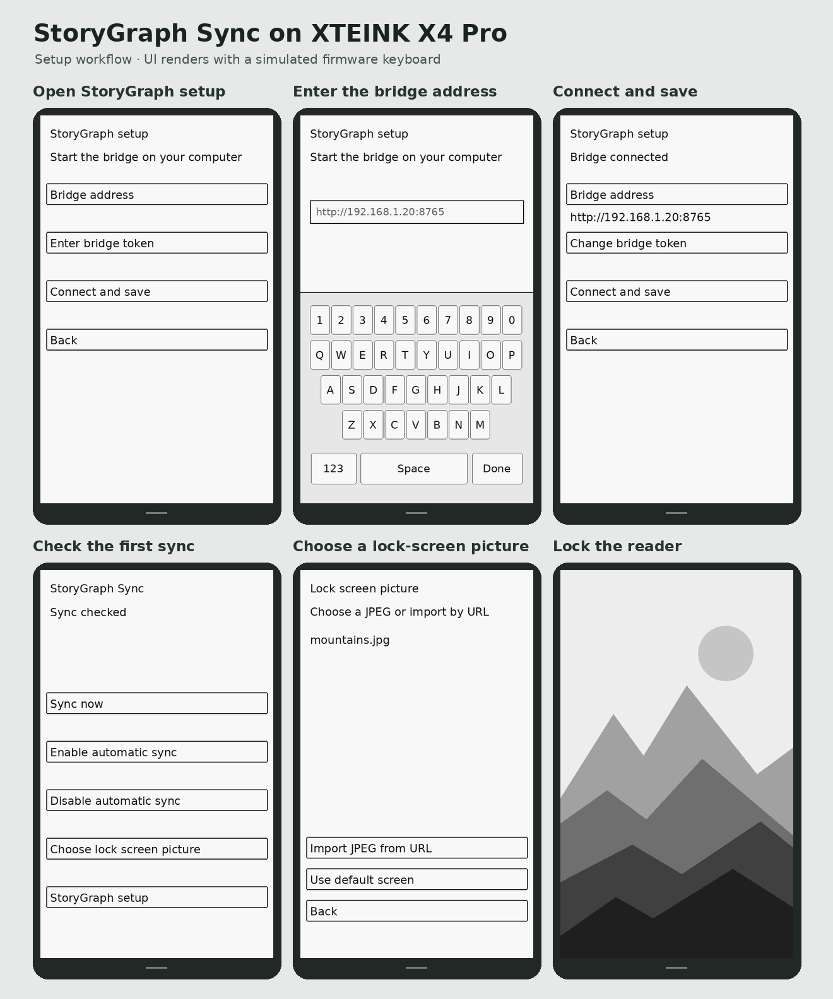

# StoryGraph Sync for Xteink X4 Pro

Sync your reading progress from an **Xteink X4 Pro running XTOS Licorice** to [The StoryGraph](https://thestorygraph.com/). Connect the reader to a local bridge once, then the app uses the book metadata available on the device to find matches automatically. You can sync on demand or let the app check for progress while the reader is locked.

[Download the InkApp](https://github.com/tubbygregory/licorice-storygraph-sync/raw/refs/heads/main/storygraph.xtapp) · [Download the bridge files](https://github.com/tubbygregory/licorice-storygraph-sync/archive/refs/heads/main.zip) · [View the setup screens](docs/setup-workflow.png)

## Before you start

- **Reader** — Xteink X4 Pro with stock XTOS Licorice build `26111201` or later.
- **Computer** — Python 3.10 or later and a computer that can stay on while you sync. The reader needs Wi-Fi access to this computer.
- **Account** — A StoryGraph account and an active browser session. The bridge uses your own session to submit progress through StoryGraph’s website.

This is an unofficial integration. The project has been tested with simulated reader and StoryGraph responses. Physical hardware and live StoryGraph writes remain unverified.

## Get started

### 1. Install the InkApp

Copy `storygraph.xtapp` to the root of the reader’s SD card. On the reader, open **All Files**, tap the package to install it, then launch **StoryGraph Sync** from the **Ink App** drawer.

If you’re upgrading, update both the InkApp and the bridge. Keep your existing `bridge.json` to preserve saved book matches.

### 2. Start the bridge on your computer

Extract the [project ZIP](https://github.com/tubbygregory/licorice-storygraph-sync/archive/refs/heads/main.zip) and open the extracted folder in a Bash terminal. Create a Python environment and generate a pairing token.

```bash
python -m venv .venv
. .venv/bin/activate
python -m pip install -r requirements.txt
python -c 'import secrets; print(secrets.token_urlsafe(32))'
```

Create a file named `bridge.json` in that folder and replace the placeholder with the generated token.

```json
{
  "token": "paste-your-generated-token-here",
  "books": {}
}
```

While signed in to StoryGraph, open **Developer Tools → Network** in your browser and reload a StoryGraph book page. Select the request to `app.thestorygraph.com` and copy the **Cookie** value under **Request Headers**. It should contain `_storygraph_session`. Keep this value private.

Run the following commands, paste the cookie at the prompt, and replace `192.168.1.20` with your computer’s local network address.

```bash
read -rs -p 'StoryGraph Cookie header: ' STORYGRAPH_COOKIE
export STORYGRAPH_COOKIE
python bridge.py --bind 192.168.1.20
```

Leave the bridge running on your private network. The reader only needs the bridge address and pairing token.

### 3. Connect the reader and try a sync

1. Open **StoryGraph Sync → StoryGraph setup**.
2. Enter the **Bridge address**, such as `http://192.168.1.20:8765`, and the token from `bridge.json`. Tap **Connect and save**.
3. Read a few pages on the X4 Pro, then return to **StoryGraph Sync** and tap **Sync now**. Check the book’s progress in StoryGraph to verify your first update.
4. For hands-off sync, tap **Enable automatic sync** and confirm the firmware prompt. This makes StoryGraph Sync your lock screen. It checks for progress when the reader locks and on roughly 15-minute wakes while Wi-Fi is available.

<details>
<summary>See the setup screens</summary>



The preview uses the app’s drawing code with a simulated firmware keyboard and network.

</details>

## How book matching works

The app sends the title and author that Licorice exposes. The bridge looks for a unique exact match in StoryGraph, or verifies the ISBN if the reader supplies one. It saves successful matches for future syncs. Books with insufficient metadata or ambiguous matches are skipped.

The bridge advances the reading percentage. It can mark an untracked match **Currently Reading** when you’re partway through the book. Finish status and rereads are managed in StoryGraph.

## Use your own lock-screen picture

Open **StoryGraph Sync → Choose lock screen picture**. Pick a JPEG you copied over USB to `XTApps/storygraph/files/` on the SD card, or tap **Import JPEG from URL** and enter a direct HTTPS link to the image. Use JPEGs up to **480 × 800 pixels** and **512 KiB**. A 480 × 800 portrait image fills the display.

The picture appears while the reader is locked and sync continues in the background. Select **Use default screen** to restore the app’s built-in lock screen.

## Troubleshooting

| What you see | What to check |
| --- | --- |
| **Could not contact bridge** or **Bridge unavailable** | Keep the bridge running, confirm both devices can reach each other on the local network, and use the computer’s address with port `8765`. |
| **Bridge token rejected** or **Check bridge token** | Re-enter the exact token from `bridge.json`. |
| **Check bridge version** | Update the InkApp and the bridge files together. |
| **No syncable StoryGraph match** | Check that the EPUB has the correct title and author and that a matching edition exists in StoryGraph. The bridge skips uncertain matches. |
| **Check StoryGraph bridge log** | Check the terminal running the bridge for details. If the browser session expired, sign in again, copy the updated Cookie header, and restart the bridge. |
| **Sync checked** but progress is unchanged | Read a few more pages and verify the reading percentage on the StoryGraph edition page. An unchanged percentage can mean StoryGraph already has equal or higher progress. |

## More options

- [Built-in KOReader Sync](KOSYNC.txt) keeps the regular Licorice lock screen. This experimental mode requires per-book mappings and a firmware build that sends progress to a custom KOReader Sync server.
- [Full setup and build notes](README.txt) cover the bridge configuration and rebuilding the InkApp.
