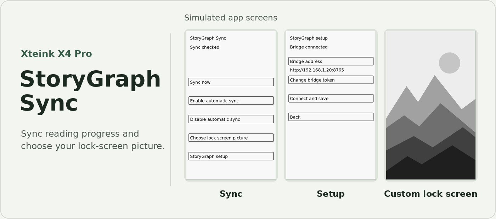
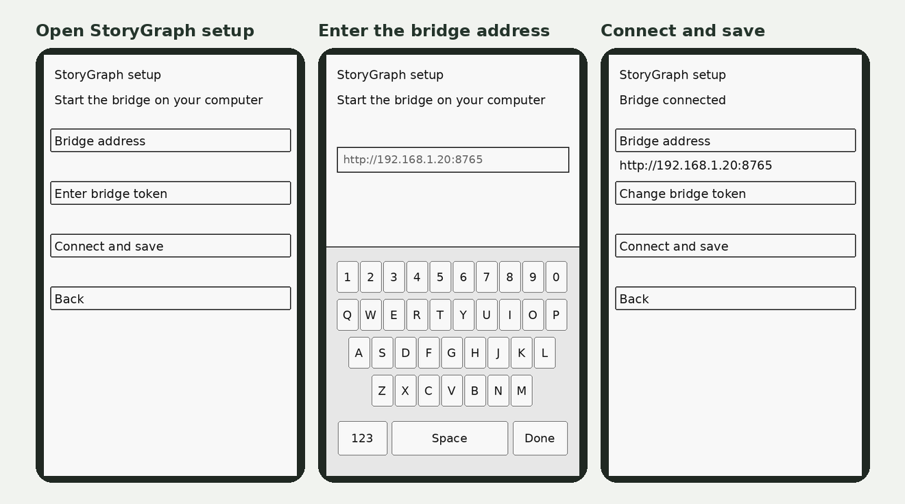

# StoryGraph Sync for Xteink X4 Pro

Bring your **Xteink X4 Pro** reading progress into **The StoryGraph**. Pair the reader with a bridge you run, then sync matched books on demand or let the app check for progress while the reader is locked.

**[Download the InkApp](https://github.com/tubbygregory/licorice-storygraph-sync/raw/refs/heads/main/storygraph.xtapp)** · **[Download the bridge files](https://github.com/tubbygregory/licorice-storygraph-sync/archive/refs/heads/main.zip)** · [Jump to setup](#get-started)



## Before you start

| You’ll need | Details |
| --- | --- |
| **Xteink X4 Pro** | Stock XTOS Licorice build `26111201` or later. |
| **Computer or server** | Python 3.10 or later for local setup, or Docker Compose v2 on a Linux server. Keep the bridge running while you sync. |
| **StoryGraph account** | An active browser session. The bridge uses that session to send progress through StoryGraph’s website. |

> [!NOTE]
> This is an unofficial integration. The screen renders and sync tests use simulated responses. Physical hardware and live StoryGraph writes remain unverified.

Follow the steps below to run the bridge on Windows, macOS, or Linux. To sync while your computer is off, use the [server setup guide](docs/server-setup.md) to run the bridge on a home server or VPS you manage.

## Get started

### 1. Install the InkApp

Copy `storygraph.xtapp` to the root of the reader’s SD card. On the reader, open **All Files**, tap the package to install it, then launch **StoryGraph Sync** from the **Ink App** drawer.

If you’re upgrading, update both the InkApp and the bridge. Keep your existing `bridge.json` to preserve saved book matches.

### 2. Start the bridge on your computer

Extract the [project ZIP](https://github.com/tubbygregory/licorice-storygraph-sync/archive/refs/heads/main.zip) and open a terminal in the extracted folder. Run the commands for your operating system to create a Python environment and generate a pairing token.

**Windows PowerShell**

```powershell
py -3 -m venv .venv
.\.venv\Scripts\python.exe -m pip install -r requirements.txt
.\.venv\Scripts\python.exe -c "import secrets; print(secrets.token_urlsafe(32))"
```

If your Python installation provides `python` instead of `py`, run `python -m venv .venv` as the first command.

**macOS or Linux**

```bash
python3 -m venv .venv
./.venv/bin/python -m pip install -r requirements.txt
./.venv/bin/python -c 'import secrets; print(secrets.token_urlsafe(32))'
```

Create a file named `bridge.json` in that folder and replace the placeholder with the generated token.

```json
{
  "token": "paste-your-generated-token-here",
  "books": {}
}
```

While signed in to StoryGraph, open **Developer Tools → Network** in your browser and reload a StoryGraph book page. Select the request to `app.thestorygraph.com` and copy the **Cookie** value under **Request Headers**. It should contain `_storygraph_session`. Keep this value private.

Find your computer’s IPv4 address on the local network the reader will join.

- **Windows** — Run `ipconfig` and look for **IPv4 Address** under your active Wi-Fi or Ethernet adapter.
- **macOS** — Open **System Settings → Network**, select the active connection, and check **Details → TCP/IP**.
- **Linux** — Run `ip -brief -4 address` and use the address on your active Wi-Fi or Ethernet interface, without the trailing `/…`.

Replace `192.168.1.20` with that address in the command for your operating system. Paste the Cookie value at the hidden prompt and press Enter.

**Windows PowerShell**

```powershell
$cookie = Read-Host "StoryGraph Cookie header" -AsSecureString
try {
    $env:STORYGRAPH_COOKIE = [System.Net.NetworkCredential]::new('', $cookie).Password
    .\.venv\Scripts\python.exe bridge.py --bind 192.168.1.20
}
finally {
    Remove-Item Env:\STORYGRAPH_COOKIE -ErrorAction SilentlyContinue
    $cookie.Dispose()
    Remove-Variable cookie
}
```

**macOS or Linux (Bash or Zsh)**

```bash
(
  printf 'StoryGraph Cookie header: '
  IFS= read -rs STORYGRAPH_COOKIE
  printf '\n'
  export STORYGRAPH_COOKIE
  ./.venv/bin/python bridge.py --bind 192.168.1.20
)
```

Leave the bridge running on your private network. The reader only needs the bridge address and pairing token.

### 3. Pair the reader and verify the first sync

1. Open **StoryGraph Sync → StoryGraph setup**.
2. Enter the **Bridge address**, such as `http://192.168.1.20:8765` at home or `https://sync.example.com` for a server, and the token from `bridge.json`. Tap **Connect and save**.
3. Read a few pages on the X4 Pro, then return to **StoryGraph Sync** and tap **Sync now**. Open the book in StoryGraph to verify your first update.
4. For automatic sync, tap **Enable automatic sync** and confirm the firmware prompt. This makes StoryGraph Sync your lock screen. It checks for progress when the reader locks and on roughly 15-minute wakes while Wi-Fi is available.



[View the full setup and lock-screen walkthrough](docs/setup-workflow.png).

## How book matching works

The app sends the title and author that Licorice exposes. The bridge looks for a unique exact match in StoryGraph, or verifies the ISBN if the reader supplies one. It saves successful matches for future syncs. Books with insufficient metadata or ambiguous matches are skipped.

The bridge advances the reading percentage. It can mark an untracked match **Currently Reading** when you’re partway through the book. Finish status and rereads are managed in StoryGraph.

## Use your own lock-screen picture

Open **StoryGraph Sync → Choose lock screen picture**. Pick a JPEG you copied over USB to `XTApps/storygraph/files/` on the SD card, or tap **Import JPEG from URL** and enter a direct HTTPS link to the image. Use JPEGs up to **480 × 800 pixels** and **512 KiB**. A 480 × 800 portrait image fills the display.

The picture appears while the reader is locked and sync continues in the background. Select **Use default screen** to restore the app’s built-in lock screen.

## Troubleshooting

| What you see | What to check |
| --- | --- |
| **Could not contact bridge** or **Bridge unavailable** | Keep the bridge running. For a local bridge, check the local IP and port `8765`. For a remote bridge, check the HTTPS address and the server logs. |
| **Bridge token rejected** or **Check bridge token** | Re-enter the exact token from `bridge.json`. |
| **Check bridge version** | Update the InkApp and the bridge files together. |
| **No syncable StoryGraph match** | Check that the EPUB has the correct title and author and that a matching edition exists in StoryGraph. The bridge skips uncertain matches. |
| **Check StoryGraph bridge log** | Check the terminal running the bridge for details. If the browser session expired, sign in again, copy the updated Cookie header, and restart the bridge. |
| **Sync checked** but progress is unchanged | Read a few more pages and verify the reading percentage on the StoryGraph edition page. An unchanged percentage can mean StoryGraph already has equal or higher progress. |

## More options

- [Built-in KOReader Sync](KOSYNC.txt) keeps the regular Licorice lock screen. This experimental mode requires per-book mappings and a firmware build that sends progress to a custom KOReader Sync server.
- [Full setup and build notes](README.txt) cover the bridge configuration and rebuilding the InkApp.
